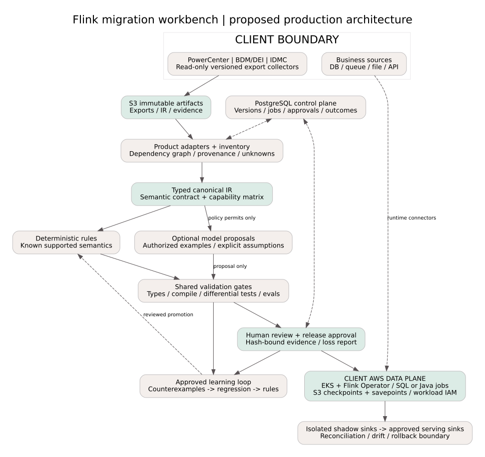
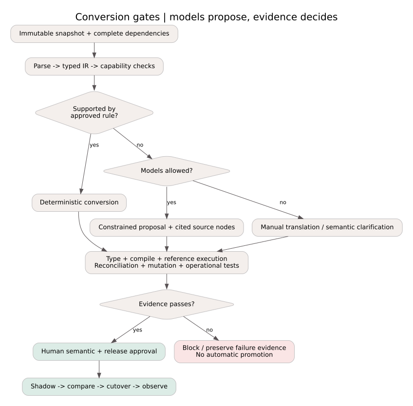

# High-level design: Flink migration workbench

Version 1.0 | 5 November 2026 | HLD plus bounded proof of concept

## 1. Design position

Treat migration as a compiler and evidence problem, not a prompt-to-code problem. The unit of migration is an execution contract, not a mapping file. A ten-year estate includes reusable transforms, workflows, schedules, parameter files, custom SQL, stored procedures, scripts, implicit assumptions and side effects. Moving visible boxes alone is unsafe.

Use two conversion lanes sharing one typed intermediate representation (IR), deterministic validation and evidence-based release process. Rules handle known semantics. Models may propose uncertain translations but cannot approve their own output. A no-model deployment retains the same compiler and gates, routing unsupported cases to manual translation.

The proposed runtime is upstream Flink, self-managed by the client on AWS: isolated application clusters on EKS, Flink Kubernetes Operator, S3 checkpoint/savepoint storage and workload identity. This is a recommendation, not a deployed environment. EKS manages the Kubernetes control plane; it does not make Flink a fully managed service.

## 2. Ingestion and inventory

Separate metadata ingestion from business-data movement. First collect definitions through read-only collectors inside the client network, approved service identities and narrowly scoped export access. Use encrypted transfer or approved offline bundles. Record tenant, product/version, repository/folder, snapshot time, dependency completeness, adapter version, capture failures and content checksums. Source changes invalidate old conversion evidence.

### Product adapters

- **PowerCenter:** use approved `pmrep ObjectExport` XML plus dependency inventory. Documented `-b` and `-r` flags export non-reusable and reusable dependencies. Also inspect shortcuts, workflows and external references. Use a controlled local schema; never fetch a DTD from the network.
- **BDM/DEI:** a separate version-tested adapter for the product's repository/application exports and supported command-line interfaces. Do not assume PowerCenter XML and Developer-tool models are interchangeable. Real export samples and API entitlements are a discovery prerequisite. This adapter is a feasibility spike, not implemented support.
- **IDMC:** use the supported service/release export interface. The referenced platform-v3 export resolves object IDs, starts a job, polls its status and downloads a ZIP. Verify that interface's applicability and asset coverage for each tenant/service. Apply backoff with jitter, resume checkpoints, archive path/expansion limits and checksums. A downloaded package does not prove dependency completeness.

Capture connection references, schemas/types, precision/scale, field lineage, mapping graphs, expressions, lookup cache settings, SQL overrides, session settings, parameter overrides, workflow dependencies, scheduling/calendar/timezone, UDF versions, error/reject paths, external scripts and run statistics. Secrets remain in the client secret store, not in IR, logs or prompts. Mask sensitive expressions and minimize samples under client policy.

Interview owners and inspect approved logs for implicit rules, data skew, volumes, restart behavior and business SLAs. A coverage report must list missing dependencies and unexportable artifacts. Do not silently skip unknowns. Never execute source scripts merely to inspect them.

During target execution, connector adapters separately connect Flink to databases, queues, files and APIs. Decide batch snapshot versus CDC per pipeline. Snapshot plus CDC requires a consistent snapshot/log-offset boundary to avoid gaps and duplicates. Verify connector/database/version/license support and replay retention before promising recovery. Exporting metadata is not copying production data.

## 3. Landing stores

| Store | Content | Reason and controls |
|---|---|---|
| S3 | Immutable exports, large IR/code artifacts, test inputs/outputs and manifests | Versioned object storage; private access, SSE-KMS, tenant isolation, retention and hashes |
| PostgreSQL | Jobs, graph edges, versions, capability matrix, approvals and evaluation results | Transactions and searchable state; idempotency keys, tenant policies and backups |
| Optional pgvector | Approved redacted example embeddings | Tenant-filtered similarity retrieval only; not a correctness authority; absent in deterministic mode |
| Existing stores or isolated S3/Iceberg test tables | Approved business snapshots and test outputs | Reproducible comparisons without copying the whole estate; deletion and data-access policies |
| Separate S3 state paths | Checkpoints, savepoints and HA metadata | Durable recovery; distinct permissions/retention and restore drills |

Start with PostgreSQL edges and recursive queries. Add a graph database only if measured impact-analysis demand justifies another operational system. Artifact storage and a relational metadata database solve different problems. No production storage is provisioned by this repository.

## 4. Canonical IR and semantics

A production IR carries schema/version, source pointers, typed ports and graph edges, expression AST, transforms, UDF references, workflow dependencies, provenance and unknown nodes. Its semantic envelope records bounded/unbounded mode, changelog behavior, inserts/updates/deletes, event versus processing time, watermarks, late events, ordering, duplicate handling, null/empty-string rules, collation, decimal rounding, timezones, transactions and side effects.

Normalize syntax without losing behavior. An `IIF` can become a conditional only after matching source type/null rules. A lookup might mean a bounded join, temporal join, cached lookup or per-row query. Sequence generators, transaction-control nodes and arbitrary scripts may require custom operators or manual redesign. Preserve unknown semantics as blockers.

Maintain a matrix per source version, IR feature and target backend: exact, conditional or unsupported. A universal IR permits multiple backends; it does not guarantee every feature is portable. The prototype IR is intentionally much smaller; see SEMANTICS.md.

## 5. Conversion, assistance and learning

1. Deterministically parse and inventory. Preserve original bytes and node provenance.
2. Resolve dependencies, build typed IR, detect missing references/cycles and capture assumptions.
3. Classify supported, conditional and unsupported regions. Risk depends on side effects and behavior, not just node count.
4. Apply approved versioned rules. Emit Flink SQL for supported relational patterns and Java DataStream operators for custom state/time behavior. Keep deployment/connector configuration separate.
5. In assisted mode only, retrieve authorized approved examples and request typed proposals with source-node references and explicit assumptions for unresolved parts.
6. Deterministic validators reject invalid types, fabricated references, unknown fields, forbidden dependencies and unsupported operations. Compile in an isolated worker; run independent behavioral tests.
7. Human reviewers accept semantics and evidence. A separate release approver authorizes cutover.

Models help with ambiguous legacy idioms, lineage explanations, proposed rewrite templates, edge-case suggestions and notes. Deterministic code owns parsing, schemas, type checking, graph resolution, known-rule generation, builds, access policy, testing and promotion gates. A model never directly retrieves secrets, executes arbitrary scripts or promotes a deployment. Source comments/retrieved text are untrusted data, not instructions. Constrain model output schemas, sandbox builds, allowlist dependencies and disable worker network where practical.

**Learning loop:** record source/version, IR pattern, rule/model/retrieval versions, proposal, human edits, tests, counterexamples and decision. Separate tenant-private artifacts from reusable abstractions. Generalize a successful conversion into a candidate rule, add regression fixtures, run held-out evaluations and require approval before promotion. Similarity alone is not proof of compatibility.

Start with retrieval and rules. Train a custom model only after a measured gap and enough consented data justify it. No cross-client training by default. Version the corpus and split by client, graph and template family before training/retrieval to avoid leakage. Fine-tuning does not remove evaluation gates.

**Model orchestration:** deterministic policy router chooses classifier, source translator, target proposer or advisory reviewer by product/version, language, risk, data policy and latency budget. Exchange typed artifacts; use bounded retries, timeouts and token budgets. Model agreement is advisory, not independent proof. In no-LLM mode disable model routing and outbound access at configuration/network-policy level and queue unknowns for people. The demo itself makes no model calls.

## 6. Tests and hallucination evals

Compilation proves syntax/types, not business equivalence. Use adapter/rewrite unit tests, golden IR/provenance tests, source-reference execution and actual target execution at the same snapshot/offset. Compare typed schemas, row counts, key sets, duplicate multiplicities, nulls, decimal values, aggregates, rejects and side effects. Exact comparison is default; field-specific numeric tolerance requires approval. Partition hashes are screening, not mathematical proof.

For streaming, replay out-of-order/late events, idle partitions, updates/deletes, dedup TTL, rescaling and failures around commits. Test connector transaction semantics, schema evolution, idempotency, backpressure, recovery and replay retention. Measure p95 latency, throughput, memory/state growth, checkpoints, restore time and cost on representative workloads.

Maintain a labeled gold benchmark with accepted and unsupported cases. Measure semantic pass rate, false accepts, abstention/manual rate, unsupported-feature recall, grounding completeness and latency/cost by feature/version. A hallucination is a fabricated field/operator/reference, unjustified assumption or behavioral mismatch. Schema constraints and citations help but cannot guarantee correctness. Model confidence is never the release gate. Critical semantic mismatch blocks release. Do not invent an accuracy percentage.

The implemented evidence is 24 unit tests and one actual-Flink bounded runtime scenario with a deliberate comparison mutation. It does not execute Informatica, deploy AWS or establish full product equivalence. See EVALUATION.md for the proposed benchmark and release protocol.

## 7. Runtime and AWS operations

Separate migration control plane from target data plane. Durable job state: `discovered -> normalized -> converted -> validated -> reviewed -> shadow -> approved -> cutover -> observed -> retired`, with blocked/failed branches. Bind approvals to hashes and versions. Queue workers use retries, idempotency keys and dead-letter handling. A scheduler coordinates multi-job dependencies; Flink is not a substitute for every enterprise scheduler.

Proposed AWS deployment: private EKS network; operator-managed application clusters; workload IAM identities; encrypted S3 state; private registry; pinned Java/Flink/connector versions. Client owns patching, on-call, HA, capacity, restore tests and security operations. EC2 is an alternative if Kubernetes expertise/cost makes EKS unsuitable. No infrastructure is provisioned here.

Checkpoints must be enabled and tested with compatible connectors. Exactly-once Flink state does not automatically make external effects exactly once. Desired end-to-end guarantees require replayable sources and transactional or idempotent sinks. Arbitrary REST calls in a UDF need an outbox/idempotency design or an explicitly weaker guarantee. Verify each sink's contract.

Monitor restarts, lag, watermarks, backpressure, checkpoint duration/failures/size, state size, invalid rows and reconciliation drift. Emit dataset/job/run lineage, for which OpenLineage is a useful exchange format. Link alerts and audit events to the approved bundle. Dashboards do not replace correctness evidence.

## 8. People, cutover and rollback

Discovery owner verifies dependency coverage and business rules. Semantic reviewer resolves ambiguous nulls, timezones and lookup behavior. Security owner approves access/sample/model policy. Data/business owner accepts reconciliation and documented exceptions. Operations/release owner approves cutover and rollback readiness.

Migrate in waves: bounded/stateless first, then joins/aggregations, then stateful and side-effect-heavy workloads. Freeze/version the source, record replay boundaries, shadow-run into isolated sinks, reconcile representative periods, test restore and verify SLAs. Shadow runs must not cause duplicate payments, emails or other external effects. Change the serving pointer only after approval. Keep legacy jobs ready for a defined rollback window.

Rollback can restore compatible Flink code/state or switch consumers back to legacy and replay from a known boundary. Savepoints do not translate state between products or undo committed writes. A separate approved repair/compensation plan is required for incorrect target data. Retire legacy credentials/infrastructure only after acceptance/retention windows close.

## 9. Language and performance

Recommend Java for a production compiler/core validator and custom Flink operators because of JVM integration, type tooling and deployment fit. This is not a universal fastest-language claim. Export I/O, model calls, builds and data tests may dominate migration time. Profile first. Rust can address a measured parsing/memory-safety need at the cost of another ecosystem. Python fits this readable prototype and offline evaluation, not a claim about hot-path row-processing speed. Emit SQL/Java rather than require Python on every business row.

## 10. Extensibility and bidirectionality

Contracts: `SourceAdapter -> IR -> TargetBackend`, with capability manifests and conformance tests. Alteryx, Talend, Fivetran and Matillion each need their own adapter and semantics; a replication service is not the same thing as an arbitrary ETL engine. Other targets consume IR through backends that reject unsupported semantics.

Bidirectionality is conditional. Preserve source bytes, provenance and extension nodes; label rewrites reversible, lossy or target-specific. Only the capability intersection can round-trip exactly. Generated custom Java, arbitrary scripts and target-specific state often cannot return to an original visual mapping. Emit a loss report and require redesign/review. Reverse compilation and operational rollback are distinct problems.

## 11. Delivery phases and discovery questions

Phase 1: representative exports per product/version, inventory, semantics and security boundaries. Phase 2: low-risk converter subset plus differential harness and benchmark. Phase 3: assisted lane and learning evaluated against that baseline. Phase 4: additional transforms/connectors, stateful workloads and cutover tooling.

Before estimating coverage or schedule, establish versions/entitlements, estate size/complexity, connectors, custom-code frequency, batch versus CDC, replay limits, SLAs/RPO/RTO, residency, model restrictions, golden outputs and AWS operating skills. No migration percentage or timeline is defensible without representative assets.
